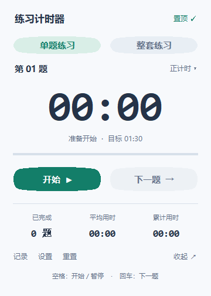
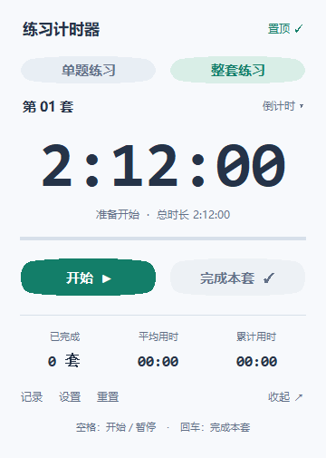

# 练习计时器

一个浅色、轻巧的 Windows 桌面计时器，适合刷题、学习和限时练习。



## 下载与启动

在本仓库的 [Releases](https://github.com/401525199/practice-timer/releases/latest) 页面下载 `PracticeTimer-v1.1.0-windows-x64.zip`，解压后双击 **练习计时器.exe**。

适用于 **Windows 10 / 11，64 位**。无需安装 Python，也无需安装程序。压缩包内附有 `使用说明.txt`；发布页提供 `SHA256SUMS.txt`，可核对下载文件的 SHA-256。

## 使用

| 操作 | 方法 |
| --- | --- |
| 切换练习方式 | 点击“单题练习”或“整套练习”页签 |
| 开始 / 暂停 | 点击按钮，或按空格 |
| 单题：完成本题并进入下一题 | 点击“下一题”，或按回车 |
| 整套：记录本套并准备下一套 | 点击“完成本套”，或按回车 |
| 修改时长 | 打开“设置”；单题默认 90 秒，整套可选 132 / 135 分钟或自定义，最长 24 小时 |
| 正计时 / 倒计时 | 点击右上角的计时模式 |
| 置顶 | 点击“置顶”切换 |
| 小窗口 | 点击“收起”，再次展开恢复完整界面 |
| 查看、导出记录 | 打开“记录”，点击“导出 CSV” |
| 清空当前模式的练习 | 点击“重置”，确认后清空 |

**快捷键仅在计时器窗口获得焦点时有效。** 计时期间可以切换到题目窗口；计时器会继续运行。

**单题模式**适合逐题练习。点击“下一题”会记录本题用时，并从零开始新题；计时中切换会继续计时，暂停时切换则保持暂停。

**整套模式**适合模拟练习，默认使用倒计时。在设置中选择 132 分钟、135 分钟，或自定义整套时长（最长 24 小时）。点击“完成本套”会暂停并记录本套用时，再准备下一套；点击“开始”后再计时。



切换“单题 / 整套”会暂停计时，两个模式分别保留自己的进度、设置和记录。“记录”“导出 CSV”“重置”只作用于当前模式。CSV 可用 Excel 打开。

记录、设置和当前进度会自动保存在当前 Windows 用户的本地应用数据目录。关闭再打开时，两个模式均恢复为暂停状态，可继续上次练习。升级到 v1.1.0 会保留 v1.0.0 的单题进度和记录。

## 从源码运行

使用 Windows 和 Python 3.11 或更新版本，并确保安装了 Tkinter（官方 Windows Python 安装包通常包含它）。应用本身只使用 Python 标准库。

```powershell
python practice_timer.py
```

运行计时逻辑的测试：

```powershell
python -m unittest discover -v
```

## 构建 Windows 下载包

在 Windows 64 位环境中执行：

```powershell
python -m pip install -r requirements-build.txt
python build_windows.py
```

输出位于 `dist/`：

- `PracticeTimer-v1.1.0-windows-x64.zip`：包含 `练习计时器.exe` 和 `使用说明.txt`。
- `SHA256SUMS.txt`：下载包的 SHA-256 校验值。

仓库的 GitHub Actions 会测试并构建 Windows 下载包，保存为工作流产物。发布到 Releases 由维护者操作。
